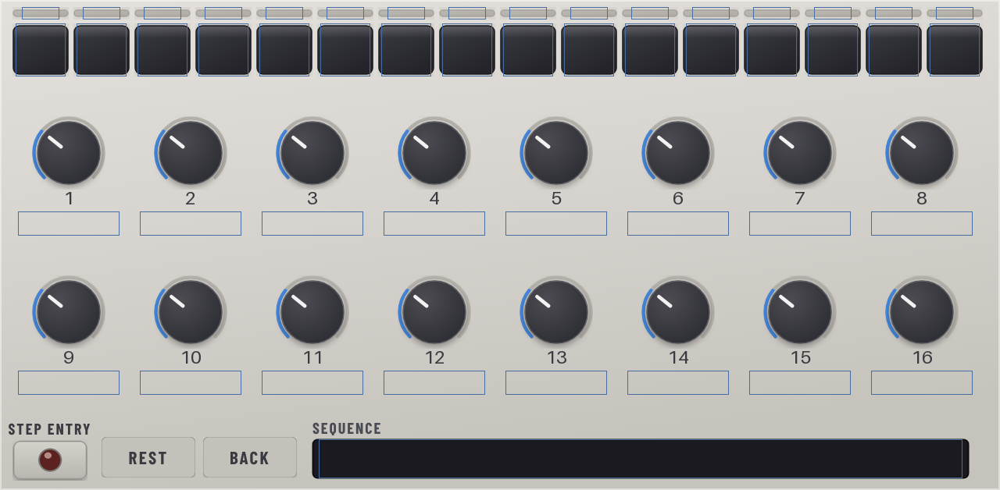

# PadStep 16 for MPC

A 16-step monophonic MIDI step sequencer, as a native VST2 plugin for MPC OS standalone. It makes no sound of its own: it plays
any other track (or outboard gear) through its own MIDI port, **"PadStep 16 / MIDI Out"**. The **16 MPC pads** turn the 16 steps
on and off, like a hardware step sequencer.



*Version française : [README.fr.md](README.fr.md)*

## Features

- 16 steps, length 1–16, step size 1/4 to 1/32, swing 50–75 %, gate 50–99 %, legato.
- Directions FWD, REV, ALT, RAND. Scales: Chromatic, Major, Minor, Dorian, Mixolydian, Harmonic Minor, Blues.
- Per step: note (scale-snapped knobs), velocity, **tie**, **slide**, **ratchet** x1–x4, **chance** 0–100 %.
- **Slide**: the next note starts before the slid one is released, so a mono synth in legato/fingered glide mode glides
  (303 style). Optional CC65 (portamento on/off) around each slide.
- **Step entry** from a keyboard or the pads, with REST and BACK.
- **Velocity master**: scale all 16 proportionally or set them all; shapes SAW, RAMP, SINE, TRI, RANDOM.
- 16 pattern slots (STORE / RECALL), RANDOM, MUTATE, rotate, REVERSE, CLEAR, 8-level UNDO.
- **Chains** of up to 32 slots, locked to the song position (start anywhere, MPC loops stay in sync).
- Pad functions SHIFT / CHAN / STORE / RECALL, pad mode STEPS or TRANSPOSE, pad LEARN.
- Everything (slots, chain, pad map) is saved with the project. Tempo follows the MPC.

## Install

Download the zip for your MPC from the [releases](../../releases):

| Zip | Devices |
|---|---|
| `PadStep-16-<version>-mpc-armv7.zip` | MPC One / Live / Live II / X / Key 61 (Gen1) |
| `PadStep-16-<version>-mpc-aarch64.zip` | MPC One G2, Live III, Key G2 (Gen2) |

Follow the `INSTALL.md` inside the zip (scripted install, or copying the folder by hand).

## First test

1. Create a plugin track with **PadStep 16**. In **Preferences → MIDI**, enable **Track** for the **PadStep 16** port.
2. Create a track with a sound, MIDI input = PadStep 16 port, channel 1, monitoring on.
3. Press **Play**: a 16-note demo pattern plays in time with the MPC.
4. Select the PadStep 16 track and hit the pads: each pad toggles its step. If pad 1 is not step 1, go to SETUP, turn on
   **LEARN** and hit pads 1 to 16 in order.

## Pages

- **SEQ**: step tiles with notes, play LEDs, 16 pitch knobs (also on the Q-Links), step entry, status line.
- **STEP+**: TIE, SLIDE and RATCHET rows, CHANCE knobs.
- **VELOCITY**: 16 sliders, MASTER level (SCALE / SET mode) and SHAPES.
- **TOOLS**: pad functions, slots, edit tools, chain.
- **SETUP**: mode, scale, rate, legato, length, swing, gate, random octaves, MIDI channel, transpose, pads, LEARN, SLIDE CC65.

## Tested

- MPC One G2, MPC OS 3.10.1 (aarch64 build).
- Host test `tools/test_port.sh` (ASan/UBSan): PASSED.
- `test/engine_test.c`: timing with jitter, loops, swing and tempo jumps; ties, slides, ratchets, chance; chains; state
  save/load including older formats; stress test with no stuck notes.

## Build

Uses the [Open MPC toolchain](https://github.com/open-mpc/mpc-vst-plugins):

```bash
git clone https://github.com/open-mpc/mpc-vst-plugins ~/mpc-vst-plugins
cd padstep-16-mpc
~/mpc-vst-plugins/tools/test_port.sh vst.json        # host test
~/mpc-vst-plugins/tools/build_port.sh vst.json all   # ARM builds and skin
# engine tests
gcc -std=gnu11 -DMIDIPORT_TEST -I ~/mpc-vst-plugins/wrapper -Isrc test/engine_test.c src/padstep_engine.c -lm -ldl -o engine_test && ./engine_test
```

## License

MIT, see [LICENSE](LICENSE). Fonts: Barlow Condensed, SIL Open Font License 1.1.
PadStep 16 is an independent project, not affiliated with Akai Professional or Arturia.
